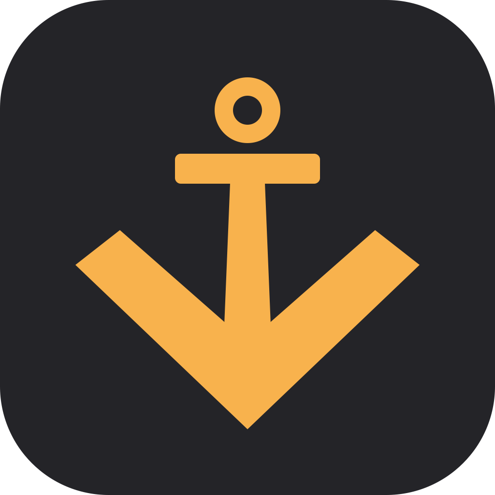
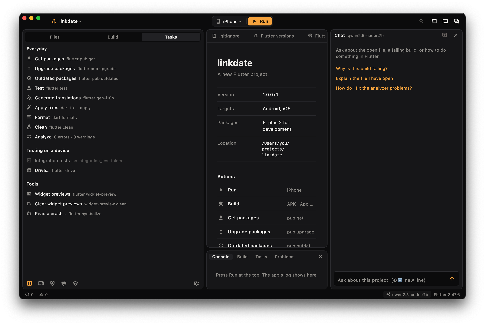
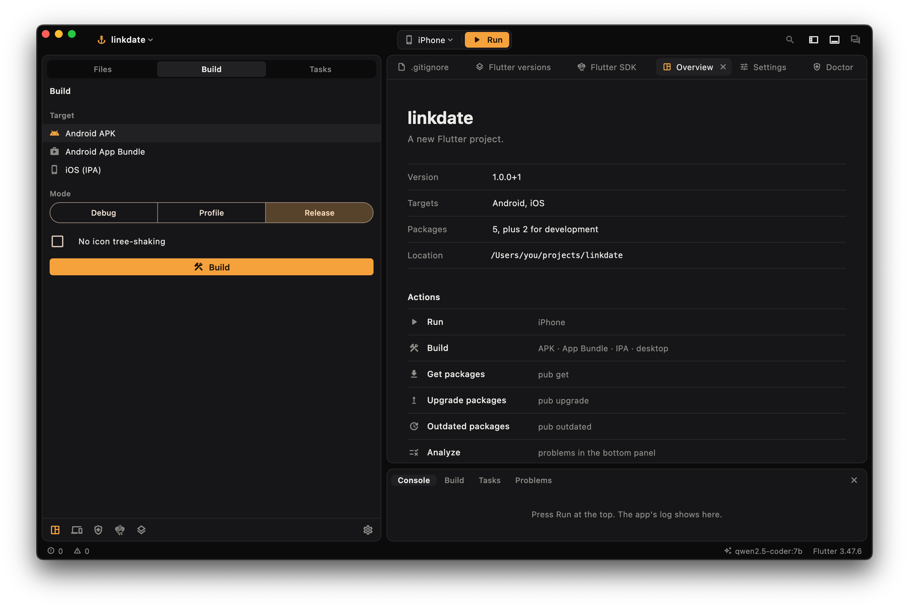
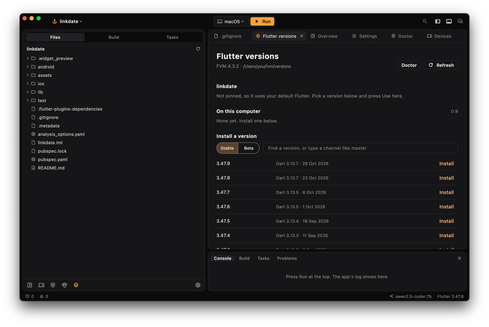
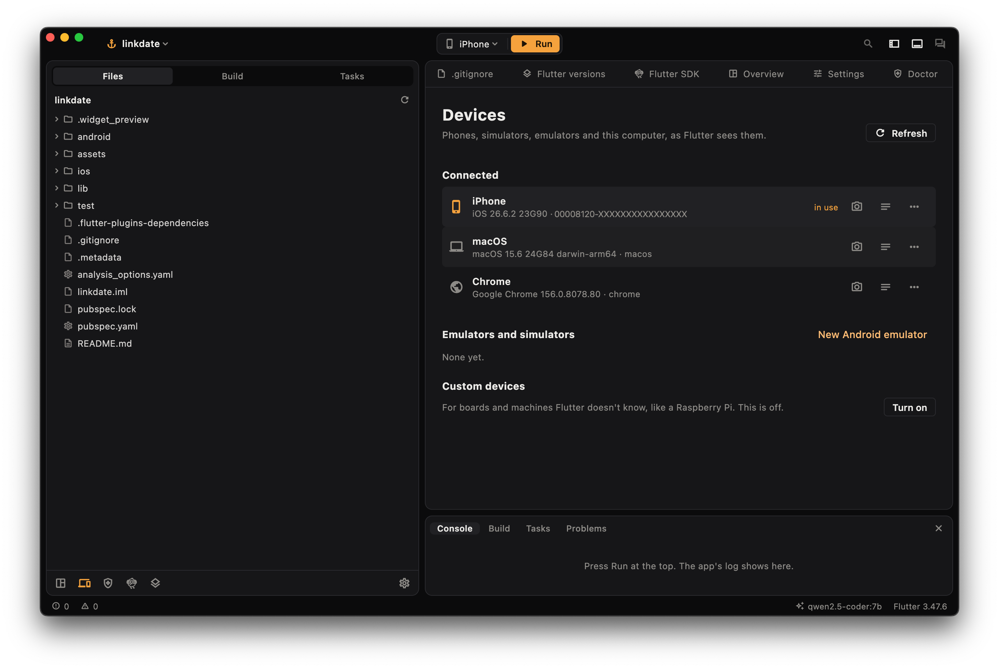
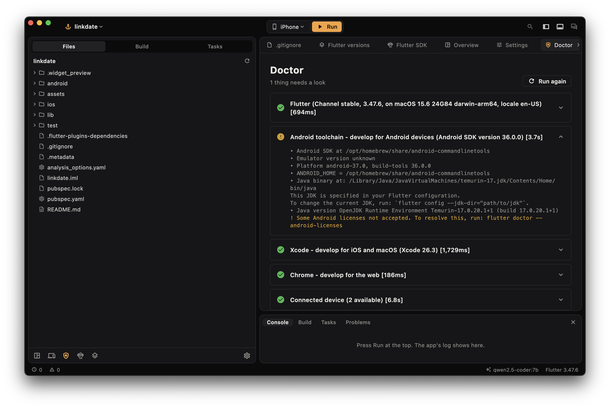

<p align="center">
  
</p>

<h1 align="center">Deckhand</h1>

<p align="center">A desktop app for your whole Flutter workflow: run, build, switch Flutter versions, and fix errors with AI that can't wreck your project.</p>



> **Early days.** Deckhand is used on macOS so far. Windows and Linux are not tested yet, and there are no installers, so you build it from source for now.

## Why Deckhand

**AI fixes you can undo.** Before any fix runs, Deckhand saves a copy of your project, with or without git. Afterwards it checks the result itself instead of trusting what the AI says: if a config file no longer reads, `flutter pub get` fails, or the same error comes back, your files go back automatically. If it worked, one click undoes it.

**Use the model you want.** Claude, OpenAI, Gemini, OpenRouter, any OpenAI-compatible server, or a local model through Ollama, where nothing leaves your computer.

**All of Flutter in one window.** Every command in the Flutter tool has a place, so you don't have to remember flags.

## What's inside

### Run and debug

A run bar that's always in reach: pick a device, run, hot reload, hot restart, stop. Logs have search and an errors filter.

### Build

APK, App Bundle, IPA, macOS, Windows and web, in debug, profile or release.



### Flutter versions

Built on [FVM](https://fvm.app). Install versions and pin one per project. Run, build, analysis and agents then all follow the project's `.fvmrc`, even after a `git checkout` changes it.



### Devices

Screenshots, device logs, install, uninstall and attach for connected devices. Start or create emulators, and add custom devices.



### Doctor

`flutter doctor` as a checklist, with the details one click away.



### Also

- File tree and read-only code viewer with tabs (**Edit** opens the file in VS Code)
- Tasks: packages, tests, translations, `dart fix`, format, clean, integration tests, `flutter drive`, widget previews, reading a crash with `symbolize`
- Flutter SDK: channels, upgrade, downgrade, precache, `flutter config` switches
- New project form, with the name checked before anything runs
- Problems panel from the analyzer: click one to jump to the line
- Coding agents: Claude Code, Aider, OpenCode, Gemini CLI or Codex, inside the same safety net
- `⌘K` for commands, `⌘P` to go to a file

## How the AI is kept safe

- **Ask AI** reads your project and explains. It can't change anything.
- **Let AI fix it** can edit files and run a fixed list of checks, and that's all. It has no terminal.
- It can't leave the project folder or follow a link out of it.
- It can't read `.env` files, signing keys or similar files.
- With a cloud model, the files it reads are sent to that provider. Deckhand asks once per provider first. A password typed into ordinary code could still be read, so a local model is the private choice.

The check catches broken projects, not logic mistakes, so read what it changed.

## Run it

You need [Flutter](https://docs.flutter.dev/get-started/install) 3.47 or newer.

```sh
git clone https://github.com/iammcoding/deckhand
cd deckhand
flutter run -d macos
```

For the AI features, add a key in **Settings**, or install [Ollama](https://ollama.com) and pull a model. Results vary a lot by model. In one test on a broken `pubspec.yaml`, `qwen3.5:4b` fixed it and `qwen2.5-coder:7b` didn't.

## Contributing

Bug reports and pull requests are welcome. Windows and Linux testing would help the most.

## License

[MIT](LICENSE)
